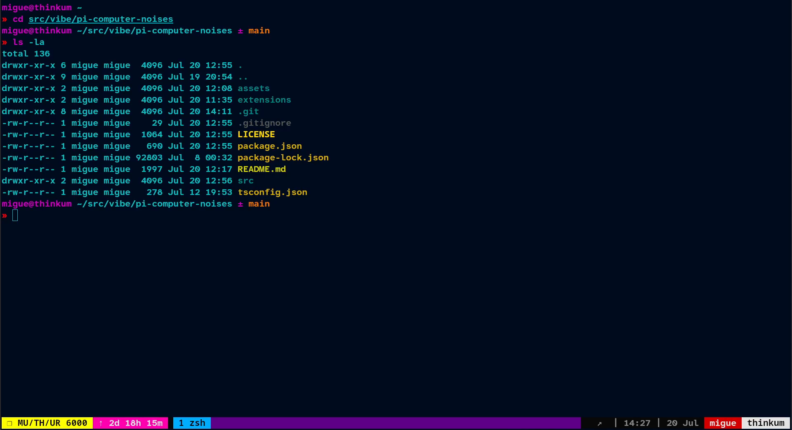

# pi-computer-noises

**Retro mainframe ambience** for pi: a 60Hz mainframe hum with data blips
while the agent thinks (70s/80s sci-fi console — WOPR, Star Trek). Fades to
silence when the last turn ends.


## How it sounds / works

- All sound is synthesized in pure TypeScript. Blips are a near-uniform
  telemetry stream of short electronic beeps at tightly-clustered pitches
  (392-523Hz) with a strong octave on top, so the stream's energy sits in
  400-1600Hz. The hum bed is a 60Hz mains stack plus the low-mid partials
  (46/69/139/262/294/370Hz) and two filtered-noise beds that give it a dense
  20-400Hz body. Sparse ambient server-room beeps play over the hum even
  between turns. The hum bed can be switched off on its own (`hum off`): blips
  keep playing, the idle drone (and its ambient beeps) goes quiet.
- The spectral balance is tuned for a dense 70s/80s console texture:
  per-octave weight sits in 400-1600Hz, the hum carries a 20-400Hz body, and
  there is little of consequence above ~2.6kHz. 13dB crest factor.
- Everything is mixed into ONE continuous PCM stream fed to a single long-lived
  raw player (`pacat` / `pw-cat` / `ffplay` / `play`) on a dedicated worker
  thread, so timing stays sample-accurate and never stutters when the host's
  event loop is busy.
- **One shared instance per user**: any number of pi agents elect a single
  audio owner (Unix socket + `O_EXCL` lock file) and refcount active turns —
  hum + blips play while ANY agent is working and stop when the LAST one
  finishes.

## Audio themes

The default is `space` (the sound above) 🚀. `robot` 🤖 restores the original
original sound: 1170-1290Hz telemetry beeps (fundamental + 3rd + 5th) over a
bare 60/120/180Hz mains drone.

Switch at runtime with the `/computer-noises` command:

```
/computer-noises                     # interactive menu (sound + hum + theme)
/computer-noises sound on|off        # mute or unmute everything
/computer-noises sound              # toggle
/computer-noises hum on|off         # silence just the idle drone
/computer-noises hum                # toggle the idle drone
/computer-noises theme robot        # switch theme directly
/computer-noises theme              # theme picker
/computer-noises status             # what is active right now
```

`hum off` only removes the idle bed (the hum tone stack plus its sparse ambient
server-room beeps): data blips still stream while the agent works, and the idle
between turns is silent. `sound off` mutes everything, hum included.

`theme default` and `theme space` are the same theme. The old names still work
as aliases: `reference` → `space`, `classic`/`legacy`/`old` → `robot`. The status
bar shows the active theme as an emoji (`🚀 space`, `🤖 robot`, `🔇 off`, plus
`· hum off` while only the hum is switched off); the command line takes plain
names. Settings persist to `<agent-dir>/computer-noises.json`
(`~/.pi/agent/computer-noises.json` by default) and are shared by every pi
instance: `sound off` silences the shared hum and all instances' blips, `hum
off` removes the shared idle drone while leaving blips on, and a theme switch
applies to the elected audio owner for everyone (the player is respawned, so a
brief gap is expected).

Environment still works and seeds the startup theme. `CN_AUDIO_THEME`, when
set, wins over the persisted one for that process, but the elected audio owner
renders for all instances, so a per-shell override only applies reliably when
that shell owns the audio:

```bash
CN_AUDIO_THEME=robot pi        # old sound
CN_AUDIO_THEME=space pi        # default
```

An unknown `CN_AUDIO_THEME` logs a warning and falls back to `space`.
Direct runs take `--theme space|robot` instead:

```bash
bun src/mainframe.ts --audition 8 --theme robot
```

[](https://www.youtube.com/watch?v=TtGsqGcajjg)

## Install on pi

```bash
pi install git:github.com/enlavin/pi-computer-noises
# or local checkout:
pi install /path/to/pi-computer-noises
```

Enable/disable with `pi config`. Remove with `pi remove /path/to/pi-computer-noises`.

## Requirements

- A raw-PCM player: `pipewire` (`pw-cat`), `pulseaudio-utils` (`pacat`),
  `ffmpeg` (`ffplay`), or `sox` (`play`).
- On Debian/Ubuntu WSL: `sudo apt install pulseaudio-utils`.
- **OS support**: WSL and native Linux. macOS/Windows-native only if `ffmpeg`
  or `sox` is installed. No raw player found → silently no-ops.

## Tuning

Edit `src/mainframe.ts`:

- Both themes live in the `THEMES` table: per theme `scale` (blip pitches),
  `blipAmp`, `partialAmps` / `partialCutoff` (blip harmonic ladder),
  `ambientScale`, `humPartials` (hum tone stack), `toneGain`, `bodyCutoff` /
  `bodyPoles` / `bodyLevel` (low noise bed), `chatterLevel` (mid noise bed),
  `humLevel` (hum loudness).
- Shared timing: `GAP_BASE` / `GAP_JITTER` (blip spacing), `WINDOW_MS` (how long
  blips linger after the last update).

Spectral regression harness (raw s16le mono at 44.1kHz on stdout):

```bash
bun src/mainframe.ts --render 12 > /tmp/on.raw              # hum + blips
bun src/mainframe.ts --render 12 --no-blips > /tmp/hum.raw  # hum only
```

[Sample audio clip](https://github.com/enlavin/pi-computer-noises/raw/refs/heads/main/assets/audition.mp3)

Audition standalone: `bun src/mainframe.ts --audition 8`
